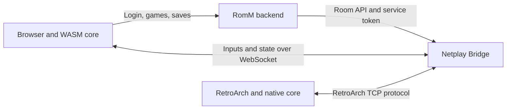

# RetroArch Netplay Bridge

A self-hosted input relay for browser cores and unmodified RetroArch clients. Each participant runs the emulation locally. The browser host supplies the initial state; late inputs are corrected by bounded rollback. The service does not stream video, run emulator sessions, or store games and saves on disk.

| Core             | Required version                  | Players                         |
| ---------------- | --------------------------------- | ------------------------------- |
| SameBoy          | `1.0.4c87d256-rollback2` (SBR2)   | Two linked GB/GBC consoles      |
| mGBA Splitscreen | `0.1.0-f1d5975-rollback1` (SPST4) | Two to four linked GBA consoles |
| Snes9x           | `1.632d4cce69`                    | One SNES, two joypads           |

The first two cores require matching native/WASM patches. Snes9x uses the pinned upstream core. All participants need identical cartridge bytes and matching core options. Linux x86_64, Windows x64/x86/ARM64 and four Android ABIs are available through the RomM adapter. See [native builds and verification limits](docs/native-builds.md) and [core qualification results](docs/core-qualification.md).

## Run

With Node 24 or later:

```sh
npm ci --ignore-scripts
export NETPLAY_BRIDGE_ADMIN_TOKEN='<at least 24 random characters>'
npm start
```

For Docker, copy `.env.example` to `.env`, replace its token and origin, then run:

```sh
docker compose up -d --build
```

The container exposes HTTP on loopback port 8082 and native TCP ports 55435–55442. It runs as a non-root user with a read-only filesystem, one CPU, and a 256 MiB memory limit. Configure the published bind addresses for the intended network. Browser connections require an HTTPS reverse proxy with WebSocket upgrade support. Native clients connect to the native hostname and room port directly.

Native connection diagnostics are JSON records on standard output. Use
`docker compose logs -f netplay-bridge` to follow accepted connections, negotiated
protocols, core/version/ROM CRC comparisons, synchronization and disconnect
reasons. Passwords, login tokens, nicknames and game/state payloads are excluded.
`native-error` includes the handshake phase; `native-core-info` includes the
received and expected ROM CRC values. A CRC mismatch requires identical ROM
bytes, including the same translation patch and revision.

In RetroArch 1.22.2's **Connect to Netplay Host** address prompt, use
`hostname|port`, for example `192.168.3.100|55435`, or configure the server address
and TCP port separately. The prompt does not split `hostname:port`.

## RomM integration

For installation, WebSocket/TCP proxy setup, web invitations and native RetroArch
connection commands, see the [RomM connection guide](https://github.com/ysteen/romm/blob/custom/netplay-retroarch-bridge/docs/NETPLAY_BRIDGE.md).



RomM owns account authentication, game access, room permissions, and save uploads. The bridge accepts administrative requests from the RomM backend using a shared service token. The token stays on the backend. Browser clients receive expiring, single-use connection tokens; native clients use RetroArch's existing room password protocol. No separate OIDC provider is needed for this adapter.

RomM rooms use a waiting room with an explicit host start. Everyone initially has no player number. Guests can select their own number; the host can assign anyone's number, including native guests. Numbers must be unique and every slot must be connected and assigned before starting. Leaving the creation password blank creates a passwordless room; web guests still sign in to RomM.

Configure the RomM backend with:

```dotenv
NETPLAY_BRIDGE_URL=http://netplay-bridge:8080
NETPLAY_BRIDGE_TOKEN=<the same shared token>
NETPLAY_BRIDGE_PUBLIC_URL=https://netplay.example.com
NETPLAY_BRIDGE_PUBLIC_HOST=netplay.example.com
```

The internal URL must be reachable from the RomM container, for example through a shared Docker network. The public URL is the browser WebSocket endpoint. The public host is used for native TCP connections. Serve the qualified core packages from RomM's emulator assets and restart RomM after changing backend configuration.

The RomM adapter lives in a separate checkout. This repository owns the reusable browser modules in `client/`; synchronize them into that checkout with:

```sh
node scripts/sync-romm-client.mjs ../romm-retroarch-sync
node scripts/sync-romm-client.mjs ../romm-retroarch-sync --check
```

See [PROTOCOL.md](PROTOCOL.md) for the backend and WebSocket contracts. RomM waiting rooms keep playing when someone leaves, transfer host controls to another browser, and admit replacements for a host-confirmed restart. The room panel shows each participant's round-trip latency to the relay beside their name. The current native password is shared by a room; per-account native credentials remain future protocol work.

## Verify and build cores

```sh
npm test
```

The tests use real local HTTP/TCP/WebSocket sockets and deterministic rollback fixtures. They need no RomM checkout or emulator binaries. [CI](.github/workflows/verify.yml) runs these tests, builds the container, and checks startup on pull requests, pushes to `main`, and manual dispatch. It does not publish an image.

Native/WASM core qualification uses the scripts and external toolchain described in the [artifact catalog](docs/core-qualification.md). Core builds are limited to two compiler workers. Generated packages carry source revisions, hashes, and license metadata.

The optional full browser integration test uses RomM's existing player and persistent browser helper. Set `ROMM_SOURCE` to that checkout, and `NETPLAY_TEST_PATCHED_ARTIFACTS` to a prepared core build before running `node test/browser-rollback-smoke.mjs`. The standalone gateway itself has no RomM runtime dependency.

## Repository layout

- `server.mjs`, `native.mjs`, `wire.mjs`: room service and RetroArch wire adapter.
- `client/`: rollback session engine and core profiles.
- `patches/`, `scripts/`: pinned core patches, builds, and adapter synchronization.
- `test/`: transport tests, original homebrew fixtures, core probes, and emulator checks.
- `docs/`: qualification evidence and compatibility details.

Licensed under AGPL-3.0; see [LICENSE](LICENSE) and [NOTICE](NOTICE). Generated emulator builds retain their upstream licenses.
