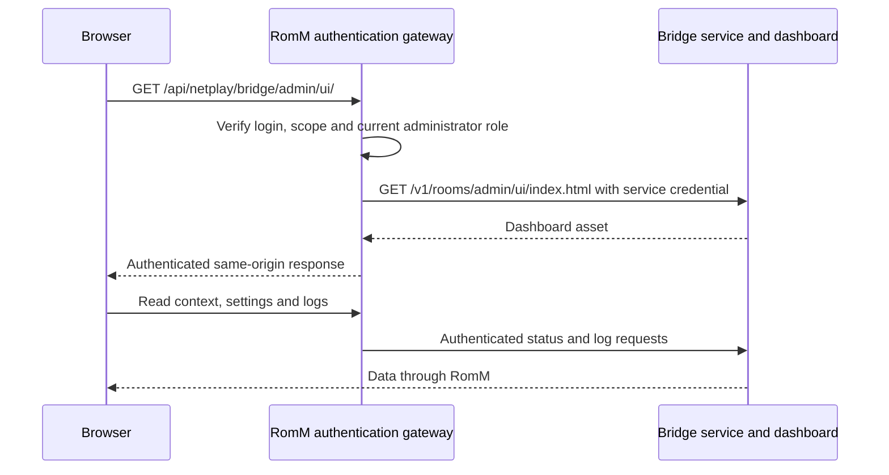

# Administration UI and application adapter

The bridge repository and container own `admin-ui/`, including the settings and
logs views, their styles and browser tests. Runtime limits, room state, filtered
diagnostic events and the durable save queue belong to the bridge. UI changes
within this contract need only a bridge update.

RomM owns account authentication, administrator authorization, ROM access and
account save uploads. Its adapter advertises public connection addresses and
stores those overrides in RomM Redis. These addresses describe the RomM
integration; listener ports, allowed origins and TLS remain deployment settings.
No emulator execution, core, battery-save or database format changes are needed.



## Open the dashboard

Sign in to RomM as an administrator, then open
`https://romm.example.com/api/netplay/bridge/admin/ui/`. RomM's previous
`/assets/emulatorjs/input-netplay/admin.html` URL redirects here. The optional [dedicated Caddy listener](../deploy/caddy/README.md) serves the
dashboard on HTTPS port 8083 and keeps the RomM login on port 8443.

The default RomM route needs no extra listener, account, OIDC provider, browser
service token or CORS configuration. Keep the ordinary RomM reverse-proxy route for `/api/`.
Do not send this URL directly to the public WebSocket transport upstream.
Anonymous requests receive 401. Non-admin accounts receive 403, even if their
token requests administrator scopes. Every UI asset, read and write is checked.
The shared service credential stays between the adapter and bridge.

## Adapter contract

The dashboard uses the parent of its `ui/` directory as its API base. It contains
no hardcoded RomM API path, cookie name or login URL. An adapter supplies these
same-origin routes:

| Route relative to the admin API                       | Method | Responsibility                                                   |
| ----------------------------------------------------- | ------ | ---------------------------------------------------------------- |
| `ui/`, `ui/index.html`, `ui/admin.js`, `ui/admin.css` | GET    | Authenticate and proxy fixed bridge assets                       |
| `context`                                             | GET    | Application name, home URL, CSRF cookie and header names         |
| empty path                                            | GET    | Account name, advertised addresses, defaults and broker overview |
| `settings`                                            | PUT    | Proxy runtime settings to the bridge                             |
| `logs?after=<cursor>`                                 | GET    | Proxy bounded diagnostic events                                  |
| `network`                                             | PUT    | Save the adapter's advertised address overrides                  |
| `saves/sync`                                          | POST   | Ask the adapter to consume pending saves                         |

The `context` response has `application_name`, `application_url`, `csrf_cookie`
and `csrf_header` string fields. The UI reads the named cookie for each request
and sends it through the named header. It never stores a service credential.
The current RomM response models define the overview and integration payloads.

The bridge accepts only `index.html`, `admin.js` and `admin.css` below
`GET /v1/rooms/admin/ui/`, using its existing service-token authentication. The
adapter uses a fixed allowlist, a 256 KiB response limit and disables upstream
redirects. Responses are not cached and receive fixed MIME types, `nosniff` and
a same-origin content security policy. The gateway is not a general URL proxy.

## Deployment and checks

The bridge Dockerfile copies `admin-ui/`; RomM contains no dashboard source
files. Update the RomM adapter once when introducing these routes, and install
the bridge image from the same release. Future compatible dashboard changes
do not require rebuilding RomM. Old installation archives retain their bundled
version; export a new portable bundle after deployment to distribute this change.

Run transport and service-asset checks with `npm test`. The optional UI harness
uses the existing RomM browser helper and closes the isolated browser:

```sh
ROMM_SOURCE=/path/to/romm node test/admin-ui-smoke.mjs
```

It checks login and role gates, CSRF forwarding, runtime/address updates,
filtered logs, safe text, downloads, revoked access, both themes, mouse, touch,
keyboard and narrow layouts. No emulator is launched. Image builds belong in CI.

## Resource usage

The Logs tab has three cards: bridge CPU, memory and network. Host CPU and memory
are neither collected nor returned. Samples refresh every five seconds while the
page is visible. CPU usage is normalized to the container quota (100% means its
allocated capacity); memory shows current cgroup usage against its limit.

Container cgroup metrics include WFC helper subprocesses. Both cgroup v2 and v1
are supported. Without readable container metrics, CPU and memory are explicitly
labelled as bridge process usage and RSS instead.

Network metrics read container interface counters, excluding loopback, and show
receive/send rates plus cumulative byte totals. They cover the bridge's HTTP,
WebSocket and native TCP traffic as well as WFC gateway traffic. Totals reset when
container interfaces are recreated. Rate calculations tolerate counter resets and
interface changes. The deployment uses a private container network namespace;
host networking is not qualified. Network usage is unavailable for a standalone
process rather than substituting host-wide traffic. An unavailable counter or
initial rate sample is not shown as zero usage.

No Docker socket, privileged access, new port or extra agent is needed. These
metrics use the same administrator-only overview endpoint as the settings.

## Standalone administrator login

Standalone administration is optional. It uses the bridge's own administrator
account and is available even when RomM is offline. The existing RomM admin
adapter and the player lobby keep their existing behavior.

Set these values for the bridge service:

```dotenv
NETPLAY_BRIDGE_LOCAL_ADMIN_USERNAME=admin
NETPLAY_BRIDGE_LOCAL_ADMIN_PASSWORD=<random password of at least 16 characters>
NETPLAY_BRIDGE_LOCAL_ADMIN_ORIGIN=https://bridge-admin.example.com
```

Use a long generated password and keep it in the deployment environment.
Use a different value for `NETPLAY_BRIDGE_ADMIN_TOKEN`, the service credential.
The bridge checks the exact HTTPS origin for browser writes. Keep its upstream
HTTP port private and proxy only `/admin` and `/admin/*` on the admin hostname.
See [the standalone Caddy example](../deploy/caddy/standalone-admin.Caddyfile.example).
The dashboard is at `/admin/`. The browser session uses a secure HttpOnly cookie,
expires after eight hours, and ends when the bridge restarts.

Under **RomM integration**, set the RomM site URL and a shared service token.
The site URL provides a navigation link. The bridge does not fetch it. Set the
same token in RomM's `NETPLAY_BRIDGE_TOKEN` and point `NETPLAY_BRIDGE_URL` to the
bridge's internal HTTP address. Maintain the RomM browser origin in
`NETPLAY_BRIDGE_ORIGINS` on the bridge. Public WebSocket and native connection
addresses remain in the RomM adapter settings. The dashboard shows the time of
the most recent authenticated adapter request as a connectivity signal.

Only one RomM integration is supported. A blank token leaves the current one in
place. If the administrator replaces it, the stored token hash takes precedence
over the service environment variable and RomM must be updated to match. The
dashboard never returns the token. Back up the bridge data volume, including
`romm-integration.json`, to retain the settings. Without a RomM integration token,
the administrator can still open the dashboard and manage the bridge.
