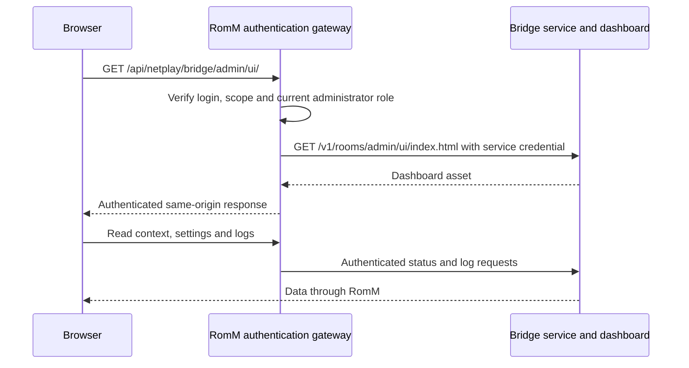

# Administration UI and application adapter

The bridge repository and container own `admin-ui/`, including the settings and
logs views, their styles and browser tests. Runtime limits, room state, filtered
diagnostic events and the durable save queue belong to the bridge. UI changes
within this contract need only a bridge update.

RomM owns account authentication, administrator authorization, ROM access and
account save uploads. Its adapter advertises public connection addresses and
stores those overrides in RomM Redis. These addresses describe the RomM
integration; listener ports, allowed origins and TLS remain deployment settings.
No emulator execution, core, battery-save or database format changes are needed.



## Open the dashboard

Sign in to RomM as an administrator, then open
`https://romm.example.com/api/netplay/bridge/admin/ui/`. RomM's previous
`/assets/emulatorjs/input-netplay/admin.html` URL redirects here. The development
LAN shortcut at port 8083 opens the same HTTPS page.

No extra admin port, account, OIDC provider, browser service token or CORS
configuration is needed. Keep the ordinary RomM reverse-proxy route for `/api/`.
Do not send this URL directly to the public WebSocket transport upstream.
Anonymous requests receive 401. Non-admin accounts receive 403, even if their
token requests administrator scopes. Every UI asset, read and write is checked.
The shared service credential stays between the adapter and bridge.

## Adapter contract

The dashboard uses the parent of its `ui/` directory as its API base. It contains
no hardcoded RomM API path, cookie name or login URL. An adapter supplies these
same-origin routes:

| Route relative to the admin API                       | Method | Responsibility                                                   |
| ----------------------------------------------------- | ------ | ---------------------------------------------------------------- |
| `ui/`, `ui/index.html`, `ui/admin.js`, `ui/admin.css` | GET    | Authenticate and proxy fixed bridge assets                       |
| `context`                                             | GET    | Application name, home URL, CSRF cookie and header names         |
| empty path                                            | GET    | Account name, advertised addresses, defaults and broker overview |
| `settings`                                            | PUT    | Proxy runtime settings to the bridge                             |
| `logs?after=<cursor>`                                 | GET    | Proxy bounded diagnostic events                                  |
| `network`                                             | PUT    | Save the adapter's advertised address overrides                  |
| `saves/sync`                                          | POST   | Ask the adapter to consume pending saves                         |

The `context` response has `application_name`, `application_url`, `csrf_cookie`
and `csrf_header` string fields. The UI reads the named cookie for each request
and sends it through the named header. It never stores a service credential.
The current RomM response models define the overview and integration payloads.

The bridge accepts only `index.html`, `admin.js` and `admin.css` below
`GET /v1/rooms/admin/ui/`, using its existing service-token authentication. The
adapter uses a fixed allowlist, a 256 KiB response limit and disables upstream
redirects. Responses are not cached and receive fixed MIME types, `nosniff` and
a same-origin content security policy. The gateway is not a general URL proxy.

## Deployment and checks

The bridge Dockerfile copies `admin-ui/`; RomM contains no dashboard source
files. Update the RomM adapter once when introducing these routes, and install
the bridge image from the same release. Future compatible dashboard changes
do not require rebuilding RomM. Old installation archives retain their bundled
version; export a new portable bundle after deployment to distribute this change.

Run transport and service-asset checks with `npm test`. The optional UI harness
uses the existing RomM browser helper and closes the isolated browser:

```sh
ROMM_SOURCE=/path/to/romm node test/admin-ui-smoke.mjs
```

It checks login and role gates, CSRF forwarding, runtime/address updates,
filtered logs, safe text, downloads, revoked access, both themes, mouse, touch,
keyboard and narrow layouts. No emulator is launched. Image builds belong in CI.
