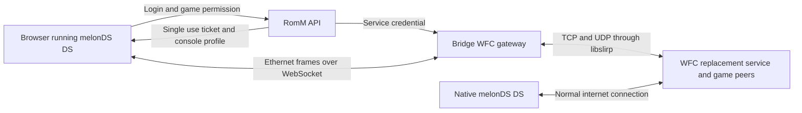

# Nintendo DS WFC

melonDS DS supports Nintendo WFC. It is a different core from EmulatorJS's older
`melonds` core. The web port is named `melondsds`, so existing games and save states
keep their original core.

## Development isolation

DS WFC is developed on `feature/ds-wfc` in both the bridge and RomM repositories.
It changes shared entry points: bridge HTTP/WebSocket routing and its image,
RomM authentication endpoints, EmulatorJS initialization and the core selector.
Keep those changes together on the feature branches until qualification is complete.
SameBoy, mGBA Splitscreen and Snes9x retain their existing rollback protocol and
core builds. WFC uses independent console instances and does not join those rooms.

The local feature worktrees are `retroarch-netplay-bridge-wfc` and `romm-ds-wfc`.
The original worktrees keep their previous branches and pending multiplayer fixes.
The feature worktrees inherit those pending fixes; they are not a clean patch
against the currently published commits. No commit or push is implied by this split.
The local staging script selects the original worktrees by default. Pass `--wfc`
to `lan-test/stage-native-session.py` to explicitly select the DS worktrees.

## Connection model

Each player runs their own DS and cartridge. The game performs matchmaking,
friend-code exchange and network play. No rollback room, shared save state,
controller forwarding, host election or RetroArch netplay password is involved.

Native melonDS DS can reach WFC directly. A browser needs the gateway because it
cannot open the UDP and TCP sockets used by the emulated DS. The bridge provides
authentication and transport for the web port, not a WFC server. Kaeru WFC is the
core's default replacement service; game support and availability depend on that
service. Use the same replacement service on both devices.

## RomM setup

1. Install a bridge image containing `wfc-slirp` and this repository's WFC module.
   Set the existing RomM bridge service token and public HTTPS URL.
2. Set `NETPLAY_BRIDGE_ORIGINS` to the exact RomM origin. WFC is unavailable when
   the allowlist is empty. The image sets `NETPLAY_WFC_HELPER` to
   `/usr/local/bin/wfc-slirp`; an empty value disables WFC.
3. Install the RomM adapter's WFC API, client module and `melondsds-wasm.data`.
4. Select `melondsds` for a Nintendo DS game. Each player signs into their own
   RomM account and starts their own game.
5. Use the game's Nintendo WFC settings and online play menu. Do not use the
   RetroArch or rollback relay room menu for this mode.

Only the HTTPS/WebSocket endpoint needs an inbound public route. The helper makes
outbound game TCP/UDP connections. The existing native rollback port range is not
used for WFC. The network must permit outbound UDP, including public WFC DNS.
NAT traversal and communication between players still depend on the game's WFC
implementation, replacement service and surrounding network.

The default build uses the interpreter and software rendering. Local DS wireless
and DSi mode are outside this port's qualification scope. This does not make games
with local wireless only support WFC.

## Saves and identity

RomM keeps each account's virtual console MAC and Wi-Fi settings in
`assets/wfc/<user-id>/console.json`. Include that directory in backups. The browser
uploads changed Wi-Fi settings every five seconds and on normal exit. An abrupt
process kill can lose changes since the last successful upload.

These settings contain WFC console registration data and are separate from game
battery saves. The normal RomM player still owns game save upload/download. One
active WFC connection is allowed per account. Different players need different
accounts. An old tab cannot save settings after switching to a different account.

Legacy melonDS battery saves have the same format as melonDS DS, with a different
usual extension (`.sav` versus `.srm`). Save states are not interchangeable. Keep
the original battery save when migrating, and retain the WFC console profile once
a game has registered it.

## Build and validation

Pinned sources:

| Component        | Revision                                   |
| ---------------- | ------------------------------------------ |
| melonDS DS 1.4.0 | `f394adbacb5722ee97c1b37c8064da9a25818310` |
| melonDS engine   | `16f127dbb587a73371827ce79689c5d237c4b59b` |
| libslirp 4.9.7   | `ce12dcddf710a71dc0de6450ec95edbadf8e9f66` |
| Emscripten       | `3.1.74`                                   |

Run `scripts/build-melonds-ds-web.sh <core-source> <EmulatorJS-RetroArch-source>
<emsdk> <output>` to apply the core patch, compile with two jobs and create
`web/melondsds-wasm.data`. The frontend must include this project's EmulatorJS
integration. The patch replaces native networking with a bounded Ethernet queue,
uses the account's MAC and persists WFC settings for generated or external firmware.

The container build compiles the gateway from the pinned libslirp source, links
against the distribution's GLib and installs its runtime dependency and license.
Use CI for image builds. `scripts/build-wfc-gateway.sh <libslirp-source> <output>`
also builds the helper independently with a C compiler, Python, pkg-config and GLib
development files. `WFC_STATIC=1` is intended for private local test overlays;
published images use dynamic GLib linking.

Run `npm test` for authentication, origin, ticket, queue and existing rollback
regressions. `node test/wfc-gateway-probe.mjs <helper>` checks DHCP, ARP and a real
Kaeru DNS response without running an emulator. The helper limits its address
space to 128 MiB and file descriptors to 256. The gateway rejects private and
special destinations, IPv6, IP options and fragmented packets.

For Windows browser qualification, `test/run-windows-wfc.ps1` uses the existing
1.5 GiB, two CPU, 60 second process-tree limiter. Test content and evidence stay
outside the repository. Do not run native emulator qualification in WSL.

Place private test content in `result/wfc-qualification/pokemon.nds` and a copy of
the battery save in `user-save.srm`. The harness installs the save before core
startup and checks the actual SRAM path. It never uploads the test battery save
to the RomM library. `menu` tests the save menu, while `wfc` executes the private
`scenario.json` from a fresh boot. `progress` may restore `user-save.state` for
menu exploration; never restore a checkpoint captured during an online connection
as evidence of a fresh network session.

The DS touchscreen uses absolute pointer coordinates. Mouse clicks and touch gestures
target the bottom screen. For `melondsds`, the adapter ignores saved mouse-lock
preferences and hides the mouse-lock setting. Virtual buttons remain interactive,
while empty space between them passes touches to the screen. Browser scrolling and
zoom gestures are disabled on the canvas. The single-threaded core also hides the
unsupported Threads setting.

For touch-only menus, hide the virtual buttons under Settings > Virtual Gamepad.
The DS touchscreen remains active with the virtual gamepad hidden.

The `controls` qualification mode restores a private, offline `wifi-ready.state`
checkpoint. It compares mouse and simulated-touch navigation, checks a saved
mouse-lock preference, and checks virtual-button release and stylus cancellation. It does not attempt
WFC login. The bounded GUI harness fixes its display scale and records screenshots;
simulated touch does not replace testing on a physical Android device.

Packet-level tests do not establish successful WFC login, matchmaking, trading or
battling. Record those results separately using the intended game and save.

### Qualification on 2026-11-07

Windows GUI Chrome loaded a private Korean Diamond cartridge (`ADAK`) and its
512 KiB battery save. The continue menu showed 40:47 played, eight badges and
498 Pokédex entries. The original save remained unchanged. The WASM heap was
about 287 MiB on a fresh boot and 345 MiB after loading a test checkpoint.

After fixing the default mouse lock, the game's connection test completed DHCP,
resolved names through Kaeru DNS and exchanged TCP/HTTP traffic with the internet
connectivity endpoint. The gateway reported no blocked frames. Authentication
then attempted `95.217.77.151:443`, with repeated unanswered TCP SYN packets over
more than 30 seconds. Direct socket connections from both the host and a container
also timed out, while the HTTP connectivity endpoint remained reachable. This
identifies a reachability problem on the authentication path in this environment;
it does not establish a worldwide outage or a successful WFC login.

The final game-level connection result is therefore **not yet qualified**. Real
trading and battling are outside the requested check. Do not describe the WebSocket,
DHCP, DNS or HTTP passes alone as successful online game connection. Evidence is
kept privately under `result/wfc-qualification/qualification.json`. The previous
non-WFC bridge also passed all 119 serial unit tests after worktree separation.

The bounded Windows Chrome `controls` run passed with virtual buttons visible:
mouse and CDP touch opened the same SSID editor, holding a pad button left only
the canvas touch in the stylus list, and touch release/cancellation cleared that
list. Saved mouse lock remained disabled and unsupported settings stayed hidden.
No browser exceptions were recorded. Evidence is in the private
`result/wfc-qualification/controls` directory. The three focused adapter test
files passed, including nine input regression cases. Physical Android validation
and WFC authentication remain separate checks.

## References

- [Official melonDS DS documentation](https://docs.libretro.com/library/melonds_ds/)
- [melonDS DS source](https://github.com/JesseTG/melonds-ds)
- [libslirp source](https://gitlab.freedesktop.org/slirp/libslirp)
- [Kaeru WFC connection instructions](https://kaeru.world/projects/wfc)
- [Poké Classic Network](https://pkmnclassic.net/)
