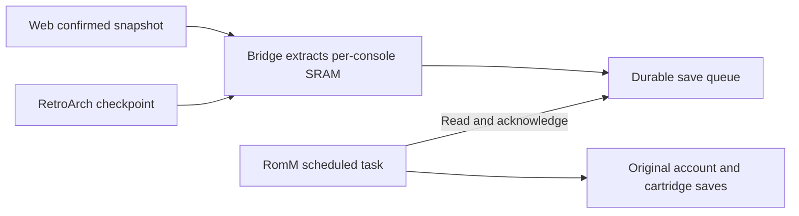

# Server save synchronization

RomM-authenticated manual-start rooms can synchronize cartridge SRAM for web and Windows RetroArch through the same server path. The broker extracts saves without running a core. RomM remains responsible for account permissions and storage.

## Configuration

Set `NETPLAY_BRIDGE_SAVE_DIR` to a writable persistent directory. Both Compose configurations use `/data/saves` and the `netplay-saves` named volume. Pending saves survive room deletion and bridge replacement when this volume is retained. Do not remove it with `docker compose down -v` during an update.

Deploy the matching RomM adapter and broker, then create new rooms. RomM's existing `NETPLAY_BRIDGE_URL` and `NETPLAY_BRIDGE_TOKEN` enable the **Sync multiplayer saves** scheduled task, once per minute. RomM's scheduler, task worker and persistent Redis storage must remain available. No callback URL, browser upload credentials, launcher update or new RetroArch protocol is needed for this path. An unconfigured queue or unsupported format retains the previous adapter behavior.

## Collection and ownership

The broker requests a confirmed web snapshot about every 15 seconds. In native-only play it requests the host's state normally every 600 frames, with the periodic save request as a fallback. Native snapshots are checked against the active generation and host progress. RetroArch's REQUEST_STATE also advances its rollback baseline and can include predicted input. The broker therefore relays that authoritative state to the other playing native clients in wire-frame order. It does not compare its CRC against their independently corrected history. Comparing those different kinds of state caused native-only sessions to disconnect during automatic saves.

The broker briefly queues outgoing inputs for the receiving native peers, waits until the source can supply a state beyond their existing wire boundary, and delivers older input, the state, then later input. Late input superseded by that state is discarded. This keeps the existing game generation and TCP sessions. A queue is bounded to 4,096 inputs and an unresponsive source times out after ten seconds; a paused room defers this timeout. Source departure releases current-generation input, while a new game discards old-generation queues. Web-confirmed CRC verification is unchanged.

Only the pinned SameBoy `1.0.4c87d256-rollback2` SBR2/BESS and `1.0.4c87d256-cable1` SBR3/BESS, mGBA Splitscreen `0.1.0-f1d5975-rollback2` SPST4 and `0.1.0-f1d5975-cable1` SPST5, and Snes9x `1.632d4cce69` snapshot layouts are accepted. SNES rooms also supply the cartridge's actual SRAM size when created. Invalid layouts are rejected rather than written. This exports SRAM, not emulator save states or separate RTC files.

Each console's save stays bound to the account, cartridge and participant fixed for that game. A replacement account cannot become the destination of an earlier participant's save. SNES has one shared console, whose SRAM is copied to each original participant's account. RomM rechecks the destination account's current write permission, keeps generation/frame ordering and detects edits made outside the session.

RomM names each room save after its cartridge using the existing version format, such as `Pokemon Gold [2026-11-07_23-00-00].srm`. The reserved name is retained across updates and retries; another room receives a separate version. Saves remain under the original account, ROM and core, in the `link` or `netplay` slot. The save selected before joining seeds the game; it is not overwritten by server synchronization. Starting a later session requires selecting the room save or using the normal latest-save selection.

## Durability and retries

The queue coalesces newer saves for the same room/account/participant/cartridge, writes by atomic rename and syncs the file and directory. At most 256 pending destinations are retained. An acknowledgement deletes only the exact revision consumed by RomM; an older acknowledgement cannot erase a newer save. Account grants and write receipts live in RomM's persistent Redis storage and survive room deletion.

Temporary failures leave the queue entry available for the next scheduled attempt. Permission failures and outside edits remain pending for intervention, appear in the room's save status and are logged by RomM. Automatic retry never force-overwrites a conflicting save. A full queue or write failure is reported without interrupting play.

Web **Sync** and **Save and return to room** wait for durable broker storage and request an immediate RomM sync. Closing a tab or abruptly terminating every native client cannot provide a final snapshot; only the latest received snapshot is recoverable. A surviving player continues to supply snapshots. The queue can drain after everyone has left without keeping the room or launcher alive.

## Verification

Serial tests cover bounded format parsing, automatic and explicit web capture, native snapshot ordering with either two-player host and a four-player room, generation changes, paused requests, source departure, frozen ownership, read/write permission, disk failure, outside edits, retry receipts, stale acknowledgements, room deletion and broker restart. Parsers were also run against existing snapshots from the three pinned cores. The room UI is checked with a simulated core.

The bounded Windows test is `test/run-windows-sameboy.ps1 -Workspace <workspace> -Content1 <rom> -Content2 <rom> -Core sameboy|mgba_splitscreen|snes9x -Mode save-sync -Label <result-name>`. Despite the historical filename, its launcher scenario covers all three cores. Use the repository's two-pad 2 KiB SRAM fixture for Snes9x. It runs two stock RetroArch 1.22.2 clients with empty launcher caches, varying Remote RetroPad inputs, 35 ms delay in each TCP direction, automatic SRAM extraction and native state relays. After inputs settle, an independent CRC comparison checks continued state agreement without reloading the receiving client. Windows substitutes only the Linux queue's directory-fsync write; durability remains covered by the Linux unit suite. Each Windows process tree has a 1.5 GiB memory limit, two CPUs and a 60-second deadline. No native emulator test runs in WSL. This short check does not qualify trades, every game, live rejoin or long-session stability.

On 2026-11-07, the delayed-input test reproduced the old SameBoy failure immediately after the first save snapshot at frame 109. With the snapshot relay fix, all three Windows x64 scenarios passed with three native state relays, one subsequent independent CRC match, saves queued for both original accounts and no connection errors:

| Core                   | Content                                                     | Completed frames |
| ---------------------- | ----------------------------------------------------------- | ---------------: |
| SameBoy SBR3           | Two distinct Gold/Silver cartridges from the user's library |            1,432 |
| mGBA Splitscreen SPST5 | Two distinct GBA cartridges from the user's library         |            1,431 |
| Snes9x                 | Two-pad homebrew SRAM fixture                               |            1,431 |

The serial protocol and client suite passed 119 tests. Results are bounded qualification evidence, not a guarantee for every commercial game.

For lag and startup ordering regressions, add `-CheckpointLag -StartupHeartbeat` to the Windows command. These options stall one client before requesting a snapshot and inject lobby keepalives during the start barrier. Before the fixes, these scenarios reproduced `Native input frames must be sequential` and RetroArch's `Netplay state load out of order`, respectively.

The combined Gold/Silver run on 2026-11-07 passed 1,433 frames with four state relays, two authorized input advances, one independent CRC match and saves queued for both accounts. The serial suite passed 122 tests. The fixes advance input counters only to an authoritative snapshot boundary and stop lobby frames once a participant is bootstrapped. Private evidence is under `result/netplay-interop/sameboy-player-view-20261107/native-start-and-snapshot-after`.

The same startup-heartbeat and forced-lag checks also passed on Windows 1.22.2 with mGBA Splitscreen using two library cartridges and Snes9x using the SRAM fixture. Both completed 1,431 frames, four state relays, one independent CRC match and save capture for both accounts, with no connection errors. Private results are in `mgba-native-start-and-snapshot-after` and `snes-native-start-and-snapshot-after` under the same evidence directory. These runs use the deployed native transport revision; they do not qualify Android or long sessions.
